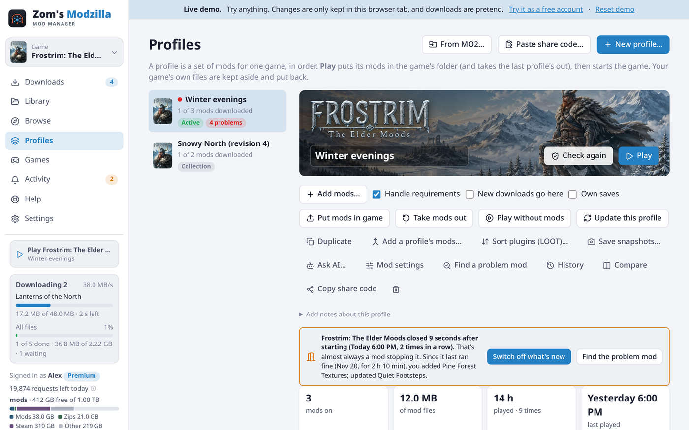
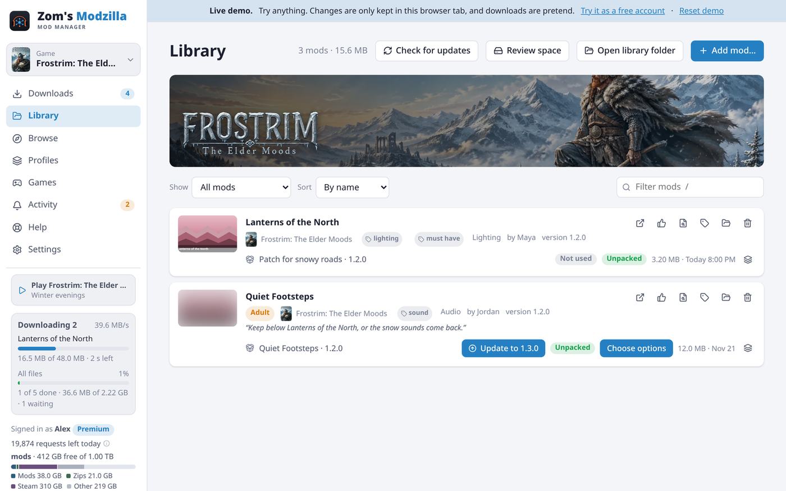
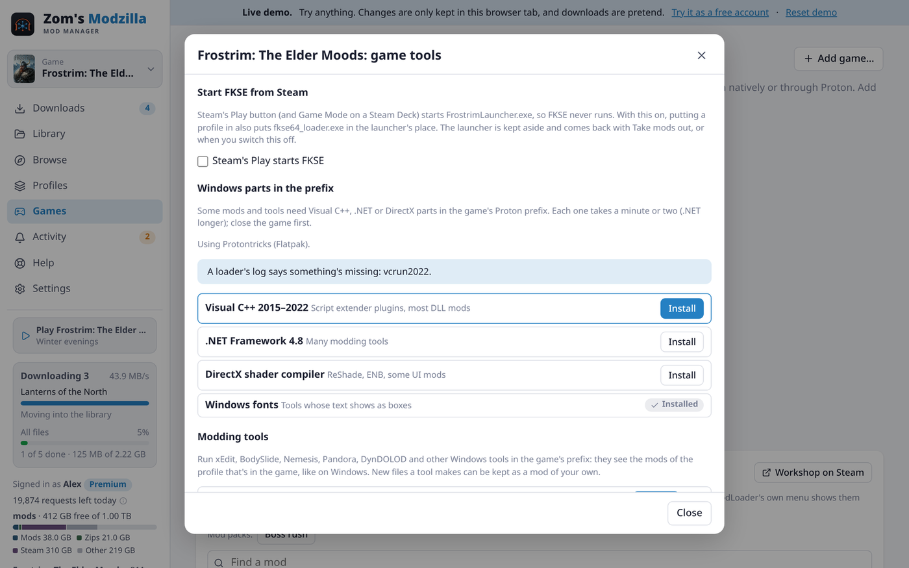
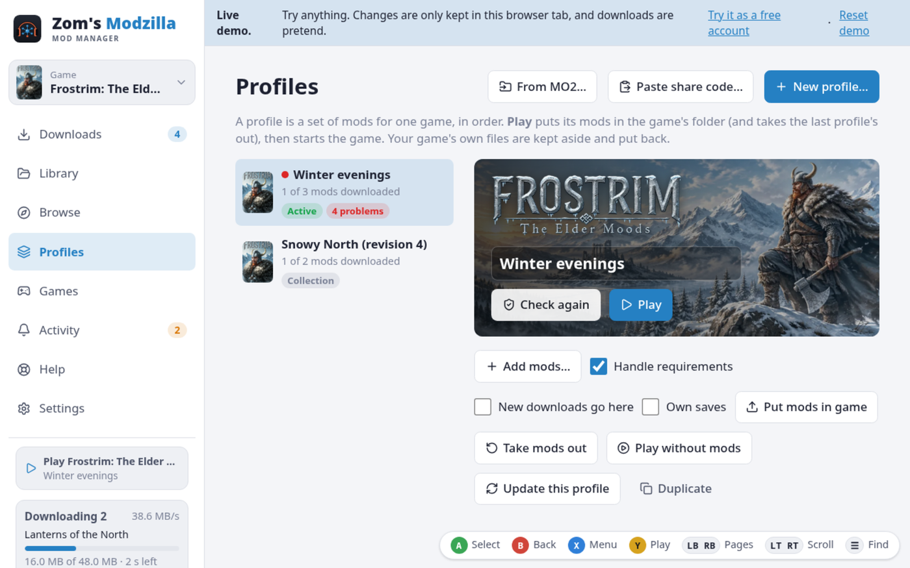
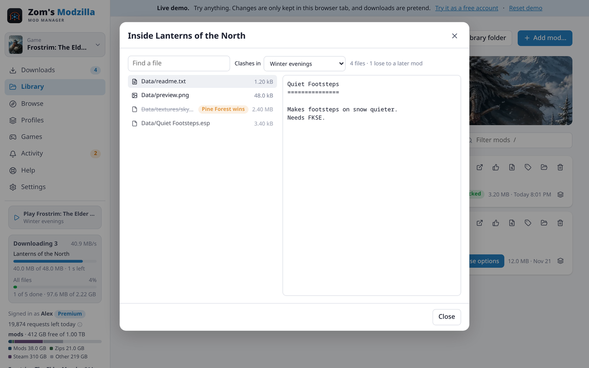

<p align="center">
  <picture>
    <source media="(prefers-color-scheme: dark)" srcset="branding/modzilla-logo-dark.png">
    
  </picture>
</p>

<p align="center">
  <b>Every mod you download, kept in order.</b><br>
  A free mod manager for Linux and the Steam Deck: Nexus Mods and Thunderstore, collections, profiles per game, a conflict check, and help when a game won't start.<br>
  No account of its own, no tracking, works in Game Mode with a controller.
</p>

<p align="center">
  <a href="https://github.com/ZomBeatz/zoms-modzilla/releases/latest"></a>
  <a href="https://github.com/ZomBeatz/zoms-modzilla/releases/latest"></a>
  <a href="https://docs.zombeatzmedia.com/modzilla/"></a>
  <a href="https://zombeatz.github.io/zoms-modzilla/"></a>
  <a href="packaging/decky"></a>
</p>

<p align="center">
  
</p>

## Quick start

**Just want to look around?** Try the [online demo](https://zombeatz.github.io/zoms-modzilla/) in your browser, with made-up games and mods. Nothing to install, and the downloads are pretend.

1. **Download** the file for your Linux from the [latest release](https://github.com/ZomBeatz/zoms-modzilla/releases/latest) (under **Assets** at the bottom):

   | Your system | File to download | Then |
   |---|---|---|
   | **Ubuntu, Linux Mint, Pop!_OS, Debian, Zorin** | `.deb` | Open it with your software installer. |
   | **Fedora, Nobara, openSUSE** | `.rpm` | Open it with your software installer. |
   | **Steam Deck, Arch, CachyOS, Bazzite, anything else** | `.AppImage` | Right-click > **Properties** > allow running it as a program, then open it. |

2. **Open Zom's Modzilla.** *Getting started* at the top walks you through it: connect your Nexus Mods account (your personal API key, which stays on your computer), let the website's **Mod manager download** buttons open the app, and find your games.
3. **Make a profile and press Play.** The profile's mods go into the game, the game's own files are kept aside, and the game starts. **Take mods out** puts it back as it came.

On a **Steam Deck**, open it once in Desktop Mode: a short setup adds it to Steam with its artwork, so it opens in Game Mode with the controller. You can sign in by scanning a QR code with your phone instead of typing.

## What it does

Zom's Modzilla does what Vortex and Mod Organizer 2 do on Windows, made for Linux, Proton and the Steam Deck.

| | |
|---|---|
| **Downloads** | From Nexus Mods (one at a time, several at once, or matched to your account) and Thunderstore. They resume after a dropped connection, a restart or sleep. |
| **Collections** | Paste a collection's address, or use its button on the website: every file is queued, with a profile made from it. |
| **Profiles and Play** | Sets of mods per game, in load order. **Play** puts them in (hard links, no extra space), starts the game, and only moves what changed when you switch. |
| **A conflict check** | Overwritten files, missing requirements and plugin masters, mods packed a folder too deep, and the Steam launch options a loader needs under Proton. |
| **When a game won't start** | Quick exits compared with the last good run, mod loaders' logs read for you, **Find the problem mod**, and optional AI help with any service. |
| **Game tools** | Script extenders (SKSE, F4SE…) started from Steam's Play, Visual C++ and .NET in the Proton prefix, xEdit and Nemesis run in the prefix, UE4SS and ReShade in one click. |
| **Steam Deck** | Controller navigation, Add to Steam, Steam's keyboard, mods on the SD card, battery-aware downloads, and a [Decky Loader plugin](packaging/decky) for switching profiles. |
| **Privacy** | No account of its own, no ads and no tracking. Your API key stays on your computer in a file only you can read. |

<table>
  <tr>
    <td width="50%"></td>
    <td width="50%"></td>
  </tr>
  <tr>
    <td></td>
    <td></td>
  </tr>
</table>

<details>
<summary><b>The full feature list</b></summary>

- **One at a time or several at once**: Match my account (Premium several, free one), one at a time in list order, or up to 8 at once, with a speed limit for all of them together. Switch any time; it takes effect right away.
- **One game at a time**: Pick a game at the top of the sidebar (your recent ones, or **All games…**) and every page shows just that game's downloads, mods and profiles.
- **Collections**: Paste a collection's address (or use its button on the website) to queue every file and get a profile made from it. Files you already have aren't downloaded again.
- **Browse**: Trending, new and just-updated mods for each game, with pictures.
- **Profiles and Play**: Sets of mods per game, in load order. Add a finished download to one in a click. Play unpacks what's still packed, puts the mods in the game's folder (hard links, game files kept aside and put back), switches Bethesda plugins on, and starts the game.
- **Conflict check**: Runs by itself whenever a profile changes: which mods overwrite which files, plugins missing a master or loading too early, mods missing what they need (as listed on Nexus Mods), and mods that run code but haven't been updated since the game was.
- **Your own mod files**: Add a mod from another site, or your own, from its zip, 7z or rar file. It works like any other mod (but stays out of mod packs).
- **Room on the drive**: Bars show how full the library's and each game's drives are. Downloads, unpacking and copying mods into a game check there's room first.
- **Mod packs**: Share a profile as a small file listing its mods; opening one queues the downloads and makes the profile.
- **Updates**: Finds newer versions of the files in your library.
- **Resume**: Pause, close the app, lose the connection: downloads carry on from where they stopped. A dropped connection is tried again by itself. Closing the window while files download keeps it going in the system tray, and it can start with your computer to finish them.
- **Download now, and in order**: Start any file straight away (the one in its slot steps aside and carries on after), sort the waiting files smallest or biggest first, and see progress in the sidebar.
- **Free and Premium accounts**: Free accounts click **Slow download** for each file, as Nexus Mods asks; the app shows the pages one after another in its own Nexus Mods window. Premium accounts get every file without clicks, several at once.
- **A tidy library**: `~/Games/Nexus Mods/<game>/<mod id> - <name>/`, with a `nexus.json` for each mod. Zip, 7z and rar files are unpacked when they finish (you can turn that off).
- **Your games**: Cover art for each one. Finds Nexus Mods games in every Steam library folder (native and Proton, Flatpak and Snap), and the Games page lists the folders it searched. Add others by hand, with their mod folder and start command.
- **Mod installers**: Mods with an installer (FOMOD) show each step with its pictures; your choices are kept for the next version, and a collection's curator choices are used by themselves.
- **Thunderstore too**: For 340+ games on Thunderstore (BepInEx, MelonLoader, Shimloader and more: Valheim, Lethal Company, R.E.P.O., Palworld …): search, get a mod with everything it needs, update all, and keep profiles made from mod packs up to date. No Overwolf.
- **Bring your setup across**: Make a profile from a Mod Organizer 2 profile (nothing downloaded again, installer choices kept) or from an r2modman profile or profile code (its config files too).
- **Each profile's own settings**: Mods' settings files (.ini, .cfg, .json …) are kept per profile, with an editor that turns them into switches and boxes.
- **When a game won't start**: Notices a game that closes right after starting and shows what changed since it last ran fine; reads mod loaders' logs (SMAPI, script extenders, BepInEx, MelonLoader, UE4SS, REFramework, Cyber Engine Tweaks, RED4ext) and names the mod at fault; warns before Play when the same crash is coming; finds loaders a profile needs but doesn't have, mods packed a folder too deep, and the Proton launch options mod loaders need. **Play without mods** and **Find the problem mod** narrow it down.
- **Ask AI (optional)**: Bring any AI service (Claude, OpenAI, Gemini, OpenRouter, or one on your own computer like Ollama): it gets the check, the logs and the last runs, with your home folder and names taken out, and only when you press Send. Answers stream in, and its suggestions (switch off a mod, find the problem mod) are buttons you choose to press.
- **Steam Deck**: A first-run setup on the Deck; **Add to Steam** puts it in your library with artwork, so Game Mode opens it full screen; the controller moves between buttons (A, B, Y, L1/R1), text boxes open Steam's keyboard (tap or A), F1–F4 for the back buttons, and mods on an SD card stay on the card. Downloads carry on after sleep, and can wait for the charger. A **Help** page answers the usual Deck questions.
- **Send from your phone**: Scan a QR code to paste your API key or a Mod manager download link on your phone instead of typing it with a controller. The page only listens while its dialog is open, and needs the code in the QR code.
- **Game tools**: Per game: **Steam's Play starts SKSE** (F4SE, NVSE, FOSE, OBSE too) so script extenders work from Game Mode; Visual C++, .NET and DirectX parts in the Proton prefix with Protontricks; xEdit, BodySlide, Nemesis, Pandora and DynDOLOD run in the prefix, with what they make kept as a mod; UE4SS and ReShade in one click.
- **Look inside a mod**: Its files, which ones lose to a later mod in the profile, its pictures and readmes. Endorse and track mods on Nexus Mods from the Library.
- **Quick access menu**: A Decky Loader plugin (`packaging/decky`) lists your profiles in the Steam Deck's **…** menu: switch a game's profile or take its mods out without leaving Game Mode.
- **More launchers**: Games from Heroic (GOG, Epic, Amazon) and Lutris as well as Steam; shows which Proton each runs with. Terraria's tModLoader mods and mod packs too.
- **LOOT sorting**: Bethesda games' plugins sorted by LOOT's community masterlist, with its notes (incompatibilities, missing requirements, plugins that need cleaning). Kept per profile, apart from the mod order.
- **Baldur's Gate 3**: .pak mods go in the game's Mods folder and on its mod list (modsettings.lsx), in the profile's order; Script Extender and loose files go in the game folder.
- **Save snapshots**: A copy of a game's saves before trying risky mods (or by itself before each Play), put back in a click; nothing is ever deleted.
- **Saves per profile**: A heavily modded profile can keep its own saves; Zom's Modzilla asks before the first Play and warns when Steam Cloud would copy saves back in.
- **Privacy**: No account of its own and no tracking. Your API key stays on your computer in a file only you can read.
- **Not done yet**: a few Thunderstore games whose mods go in as whole zips (Godot games) or into the Proton prefix (Balatro) can be browsed but not installed. Collection files hosted outside Nexus Mods have to be fetched by hand.
</details>

## Games it works with

| | |
|---|---|
| **Bethesda** | Skyrim (SE, AE, LE), Fallout 4, New Vegas, Fallout 3, Oblivion and Starfield: plugins switched on in plugins.txt, LOOT sorting (Morrowind too), script extenders from Steam |
| **Cyberpunk 2077** | Archive and script mods; Cyber Engine Tweaks, redscript and RED4ext, with the Proton launch options they need |
| **Baldur's Gate 3** | .pak mods in the game's Mods folder and on its mod list, Script Extender |
| **Stardew Valley** | SMAPI and its mods, with their own update check |
| **Thunderstore games** | 340+ games: Valheim, Lethal Company, R.E.P.O., Risk of Rain 2, Content Warning… with BepInEx, MelonLoader and more |
| **Terraria** | tModLoader's mods and mod packs |
| **Unreal Engine games** | UE4SS and its Lua mods (Palworld, Hogwarts Legacy and others) |
| **Everything else on Nexus Mods** | Any game: set where its mods go once, and it works like the rest. Steam, Heroic (GOG, Epic, Amazon) and Lutris games are found by themselves. |

## Questions

<details>
<summary><b>Do I need Nexus Mods Premium?</b></summary>

No. Free accounts click **Slow download** on the website for each file, as Nexus Mods asks; Zom's Modzilla opens the pages one after another so it's quick. Premium accounts download without clicks, several at once.
</details>

<details>
<summary><b>Does it change my game?</b></summary>

Mods go in as links to your library, and any game file a mod replaces is kept in `.zoms-modzilla-backup` in the game folder and put back with **Take mods out**. It never deletes a game file it didn't put there. Steam's own files are only read, except **Add to Steam**, which adds its shortcut while Steam is closed and keeps a backup first.
</details>

<details>
<summary><b>Can I bring my Mod Organizer 2 or r2modman setup?</b></summary>

Yes. Mod Organizer 2 profiles come across with their installer choices (nothing is downloaded again), and r2modman profiles or profile codes with their config files.
</details>

<details>
<summary><b>Where are my things kept?</b></summary>

| What | Where |
|---|---|
| Settings | `~/.config/com.zombeatz.zoms-modzilla/settings.json` |
| Your API key | `~/.config/com.zombeatz.zoms-modzilla/api-key` (only you can read it) |
| The download list | `~/.local/share/com.zombeatz.zoms-modzilla/queue.json` |
| Mods | The library folder (**Settings > Storage**), `~/Games/Nexus Mods` at first |
| Profiles | `~/.config/com.zombeatz.zoms-modzilla/profiles.json` |
| What's in each game now | `~/.local/share/com.zombeatz.zoms-modzilla/deployed/<game>.json`, and the game's own replaced files in `<game folder>/.zoms-modzilla-backup` |
| Game art | `~/.cache/com.zombeatz.zoms-modzilla/art` |
| Each profile's mod settings | `~/.local/share/com.zombeatz.zoms-modzilla/profile-settings/<profile>/` |
| How each Play went | `~/.local/share/com.zombeatz.zoms-modzilla/runs/<profile>.json` |
| The AI service's key (if you set one) | `~/.config/com.zombeatz.zoms-modzilla/ai-key` (only you can read it) |
| Thunderstore's lists | `~/.cache/com.zombeatz.zoms-modzilla/thunderstore` (fetched at most once an hour) |
</details>

<details>
<summary><b>The window is blank (NVIDIA)</b></summary>

Zom's Modzilla already turns off the WebKit setting that usually causes it. If it still happens, start it from a terminal with `WEBKIT_DISABLE_COMPOSITING_MODE=1 zoms-modzilla`.
</details>

<details>
<summary><b>Optional extras</b></summary>

Zom's Modzilla runs without these, and **Settings > This computer** says what each adds and the command for your Linux:

| For | Arch-based | Ubuntu, Debian, Mint | Fedora | openSUSE |
|---|---|---|---|---|
| A tray icon (keep downloading with the window closed) | `libayatana-appindicator` | `libayatana-appindicator3-1` | `libayatana-appindicator-gtk3` | `libayatana-appindicator3-1` |
| Notifications | `libnotify` | `libnotify-bin` | `libnotify` | `libnotify-tools` |
| Unpacking `.rar` mods (zip and 7z always work) | `libarchive` | `libarchive-tools` | `bsdtar` | `bsdtar` |
| Windows parts in Proton prefixes | `protontricks` | `protontricks` | `protontricks` | `protontricks` (or Flathub, and Discover on a Steam Deck) |
</details>

## For developers

<details>
<summary><b>Building and project layout</b></summary>

Needs Node.js 20 or newer, Rust, Tauri's Linux packages (`webkit2gtk-4.1`, `libayatana-appindicator`, `librsvg`), and libudev (`systemd-libs` on Arch, `libudev-dev` on Debian and Ubuntu) for controllers.

```bash
npm install
npm run app       # the desktop app with live reload
npm run dev       # just the page, in a browser, with made-up demo data (add ?free for a free account)
npm test          # the page's tests
cargo test --manifest-path src-tauri/Cargo.toml   # the queue, library and link tests
npm run bundle    # .deb, .rpm and .AppImage in src-tauri/target/release/bundle
```

Flathub: `packaging/flatpak/` has the manifest, desktop file and metainfo, and how to make the offline dependency lists Flathub needs. Other installs tell you when a new version is out (Settings › New versions).

- `src-tauri/src/` - the app: download queue (`queue.rs`), library, putting mods into games (`deploy.rs`), the conflict check, Thunderstore, game tools, Steam Deck support
- `src/` - the page (React and TypeScript), with `demo.ts` for the browser demo
- `packaging/` - Flathub files and the Decky Loader plugin
- `branding/` - logos and the social preview
</details>

## License

[MIT](LICENSE). Icons are [Lucide](https://lucide.dev) (ISC). The names Zom's Modzilla and ZomBeatz Media and their logos aren't covered by the license. Zom's Modzilla isn't made by or connected with Nexus Mods; it uses the public Nexus Mods API with your own key.

## Contact

Made by **ZomBeatz Media** · [info@zombeatzmedia.com](mailto:info@zombeatzmedia.com) · Reddit: [u/ZomBeatzMedia_Dev](https://www.reddit.com/user/ZomBeatzMedia_Dev/)
